# Database ERD

The entity relationship diagram for the Postgres schema. Each box is a table with its key columns only: the primary key (PK) and the foreign keys (FK). Every column, with its type, is in the [schema reference](RouteMaster-Database-Schema.md).

A line is a foreign key, labelled with the column that holds it. Reading the ends of a line:

| Mark | Meaning |
| --- | --- |
| `\|\|` | exactly one |
| `\|o` | zero or one (the key can be null) |
| `o{` | zero or more |
| `o\|` | zero or one (the key is unique, so at most one row points at the parent) |

Tables with no relationship to another table (`schema_migrations`, `session`) are left out.

## Keeping it current

The diagram below is made from the migrations by `src/db/erd.js`, not drawn by hand. After you add a migration, run `pnpm erd` to rewrite it. `src/schemaDocs.test.js` fails if the diagram, or the column lists in the schema reference, no longer match the migrations. `pnpm erd` needs `TEST_DATABASE_URL`, the same database the tests use.

A FigJam copy of this diagram is at [Routemaster database ERD (from migrations)](https://www.figma.com/board/PDGlQhPAX41nlZqXnY9Iop), brought in step with the diagram text below on 2026-11-19. It is a copy: nothing updates it, and no test checks it. After the diagram changes, update the board by following the `erd-sync` skill (`skills/erd-sync/SKILL.md`).

```mermaid
erDiagram
    customers ||--o{ access_links : "customer_id"
    link_batches |o--o{ access_links : "link_batch_id"
    users |o--o{ access_links : "created_by"
    companies ||--o{ app_settings : "company_id"
    users |o--o{ app_settings : "updated_by"
    subdivisions ||--o{ area_days : "subdivision_id"
    companies ||--o{ contact_messages : "company_id"
    users |o--o{ contact_messages : "replied_by"
    companies ||--o{ customers : "company_id"
    import_batches |o--o{ customers : "import_batch_id"
    users |o--o| customers : "user_id"
    companies ||--o{ import_batches : "company_id"
    users |o--o{ import_batches : "created_by"
    companies ||--o{ import_mappings : "company_id"
    companies ||--o{ leads : "company_id"
    customers |o--o{ leads : "customer_id"
    companies ||--o{ link_batches : "company_id"
    subdivisions |o--o{ link_batches : "subdivision_id"
    users |o--o{ link_batches : "created_by"
    access_links |o--o{ messenger_batch_recipients : "access_link_id"
    customers ||--o{ messenger_batch_recipients : "customer_id"
    messenger_batches ||--o{ messenger_batch_recipients : "batch_id"
    companies ||--o{ messenger_batches : "company_id"
    users |o--o{ messenger_batches : "created_by"
    customers ||--o{ properties : "customer_id"
    import_batches |o--o{ properties : "import_batch_id"
    subdivisions |o--o{ properties : "subdivision_id"
    customers ||--o{ reviews : "customer_id"
    service_requests ||--o| reviews : "service_request_id"
    routes ||--o{ route_stops : "route_id"
    service_requests ||--o{ route_stops : "service_request_id"
    companies ||--o{ routes : "company_id"
    users |o--o{ routes : "created_by"
    companies ||--o{ service_requests : "company_id"
    customers |o--o{ service_requests : "customer_id"
    import_batches |o--o{ service_requests : "import_batch_id"
    leads |o--o{ service_requests : "lead_id"
    properties |o--o{ service_requests : "property_id"
    request_statuses ||--o{ service_requests : "status_id"
    service_types ||--o{ service_requests : "service_type_id"
    request_statuses ||--o{ status_history : "status_id"
    service_requests ||--o{ status_history : "service_request_id"
    users |o--o{ status_history : "changed_by"
    companies ||--o{ subdivisions : "company_id"
    companies ||--o{ users : "company_id"
    roles ||--o{ users : "role_id"
    access_links {
        int4 id PK
        int4 customer_id FK
        int4 created_by FK "nullable"
        int4 link_batch_id FK "nullable"
    }
    app_settings {
        text key PK
        int4 updated_by FK "nullable"
        int4 company_id FK
    }
    area_days {
        int4 subdivision_id PK, FK
        date day PK
    }
    companies {
        int4 id PK
    }
    contact_messages {
        int4 id PK
        int4 replied_by FK "nullable"
        int4 company_id FK
    }
    customers {
        int4 id PK
        int4 user_id FK "nullable"
        int4 import_batch_id FK "nullable"
        int4 company_id FK
    }
    import_batches {
        int4 id PK
        int4 created_by FK "nullable"
        int4 company_id FK
    }
    import_mappings {
        int4 id PK
        int4 company_id FK
    }
    leads {
        int4 id PK
        int4 customer_id FK "nullable"
        int4 company_id FK
    }
    link_batches {
        int4 id PK
        int4 subdivision_id FK "nullable"
        int4 created_by FK "nullable"
        int4 company_id FK
    }
    messenger_batch_recipients {
        int4 id PK
        int4 batch_id FK
        int4 customer_id FK
        int4 access_link_id FK "nullable"
    }
    messenger_batches {
        int4 id PK
        int4 created_by FK "nullable"
        int4 company_id FK
    }
    properties {
        int4 id PK
        int4 customer_id FK
        int4 subdivision_id FK "nullable"
        int4 import_batch_id FK "nullable"
    }
    request_statuses {
        int4 id PK
    }
    reviews {
        int4 id PK
        int4 service_request_id FK
        int4 customer_id FK
    }
    roles {
        int4 id PK
    }
    route_stops {
        int4 route_id PK, FK
        int4 position PK
        int4 service_request_id FK
    }
    routes {
        int4 id PK
        int4 created_by FK "nullable"
        int4 company_id FK
    }
    service_requests {
        int4 id PK
        int4 customer_id FK "nullable"
        int4 property_id FK "nullable"
        int4 service_type_id FK
        int4 status_id FK
        int4 import_batch_id FK "nullable"
        int4 lead_id FK "nullable"
        int4 company_id FK
    }
    service_types {
        int4 id PK
    }
    status_history {
        int4 id PK
        int4 service_request_id FK
        int4 status_id FK
        int4 changed_by FK "nullable"
    }
    subdivisions {
        int4 id PK
        int4 company_id FK
    }
    users {
        int4 id PK
        int4 role_id FK
        int4 company_id FK
    }
```

<!-- erd:start -->

<!-- erd:end -->
