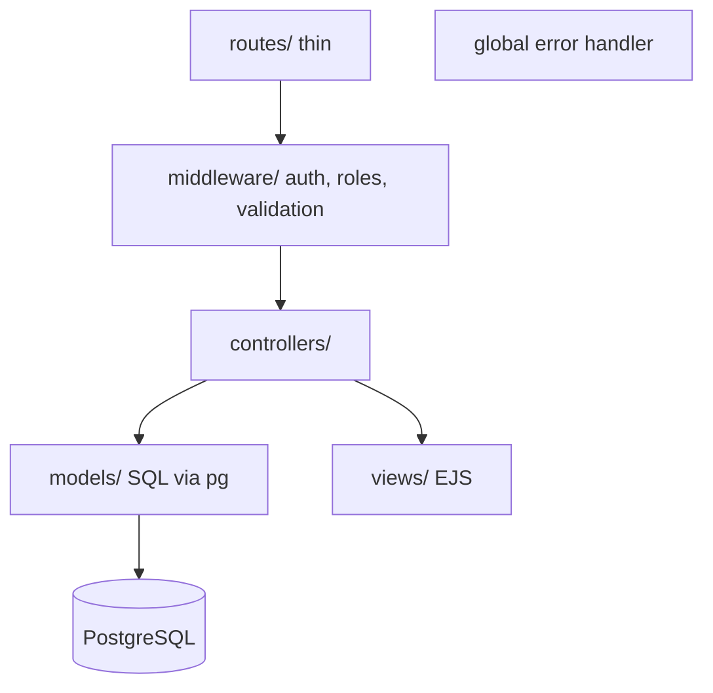

# System Overview

Status: proposed architecture from [ADR 0001](../adr/0001-app-type-and-repo-shape.md) to [0011](../adr/0011-testing-and-ci.md). Not currently implemented.

## System context

- **People:** customers (submit and track requests, leave reviews), dispatchers (build routes, move requests through statuses), the owner (everything, plus spreadsheet import).
- **App:** one server-side rendered Express app on one Render web service.
- **Data store:** PostgreSQL on Supabase, reached through `DATABASE_URL`. Sessions are also stored there.
- **External inputs:** a public Google Sheet link or an uploaded `.xlsx` file, supplied only by the owner.
- **Trust boundaries:** browser to Render over TLS; Render to Supabase over TLS; admin-supplied links and files entering the import.

```mermaid
flowchart LR
  C[Customer] --> B[Browser]
  D[Dispatcher] --> B
  O[Owner] --> B
  B -- TLS --> R[Render web service: Express + EJS]
  R -- TLS --> S[(Supabase PostgreSQL)]
  O -. link or .xlsx upload .-> R
  R -. fixed docs.google.com path .-> G[Google Sheets]
```

## Containers and components (all Not currently implemented)



Text version: requests pass `routes/`, then `middleware/`, then a controller. Controllers call models for data and render EJS views. One global error handler catches failures. See [ADR 0004](../adr/0004-mvc-app-pattern.md).
