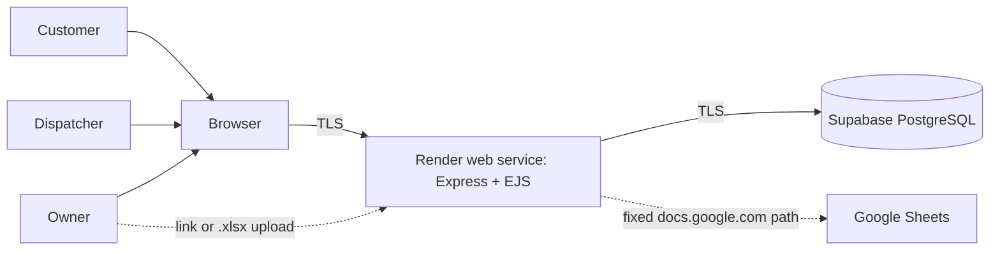
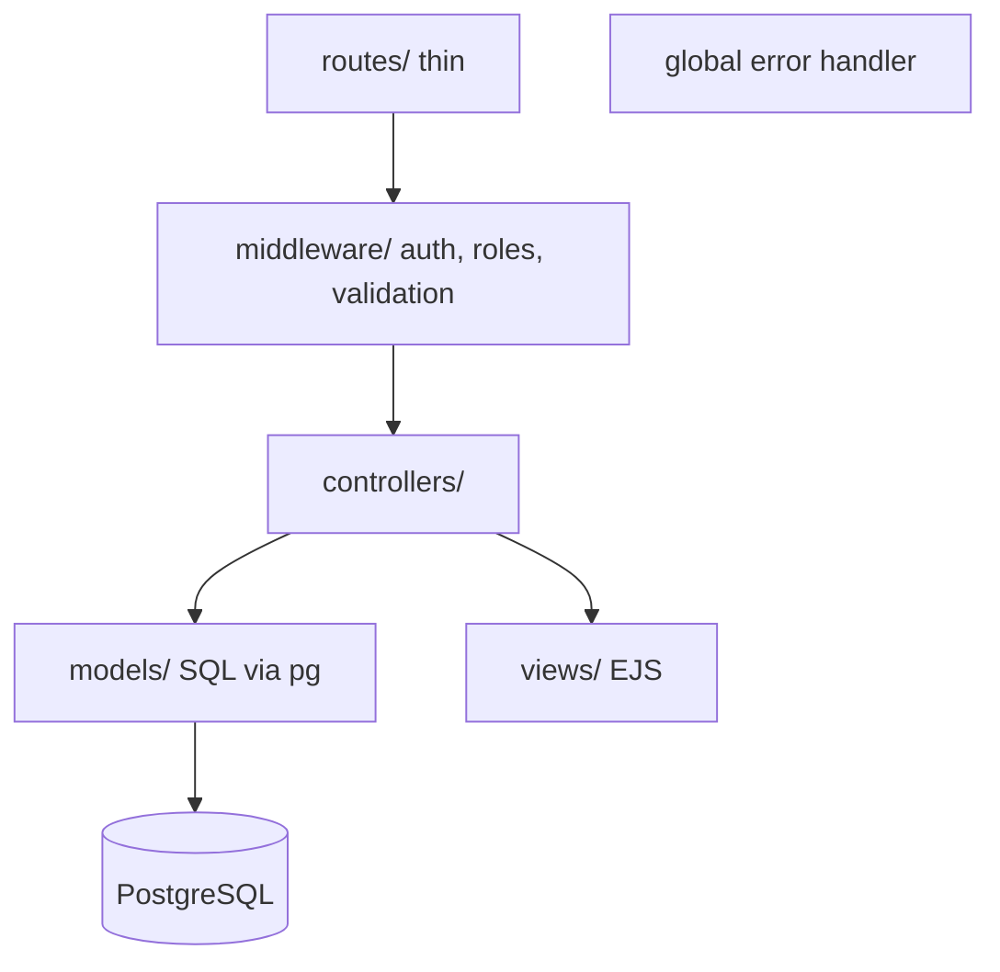

# System Overview

Status: the Express app in this diagram is built and runs locally. The Render web service, the Supabase database, and the Google Sheet import path are the planned deploy and are not built ([#21](https://github.com/masontuft/routemaster/issues/21), [#33](https://github.com/masontuft/routemaster/issues/33)). ADR 0007 stays Proposed.

## System context

- **People:** customers (submit and track requests, leave reviews), dispatchers (move requests through statuses, match Needs Review, create and revoke links), the owner (those staff actions, plus users, roles, and the service catalog). Building a daily route and spreadsheet import are not built.
- **App:** one server-side rendered Express app. The planned host is one Render web service, and that deploy is not done.
- **Data store:** PostgreSQL through `DATABASE_URL`. Sessions are rows in the same database (`session`). Supabase is the proposed production host and is not set up.
- **External inputs:** a public Google Sheet link or an uploaded `.xlsx` file, supplied only by the owner. Not built ([#33](https://github.com/masontuft/routemaster/issues/33)).
- **Trust boundaries (planned deploy):** browser to Render over TLS; Render to Supabase over TLS; admin-supplied links and files entering the import.

## Containers and components

Text version: requests pass `routes/`, then `middleware/`, then a controller. Controllers call models for data and render EJS views. One global error handler catches failures. See [ADR 0004](../adr/0004-mvc-app-pattern.md).
