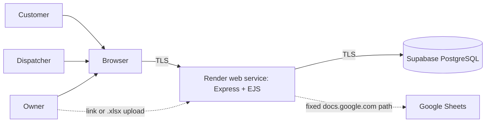
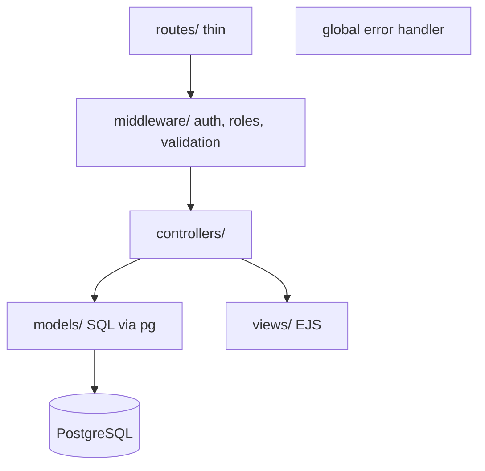

# System Overview

Status: the Express app in this diagram is built. Mason reported on 2026-11-02 that the Render web service is deployed and `/health` responds through the Supabase session pooler. The Google Sheet fetch and `.xlsx` parse modules are in `src/import/`. The import route is not built ([#33](https://github.com/masontuft/routemaster/issues/33)). ADR 0007 and ADR 0010 are Accepted.

## System context

- **People:** customers (submit and track requests, leave reviews), dispatchers (move requests through statuses, match Needs Review, create and revoke links), the owner (those staff actions, plus users, roles, and the service catalog). Building a daily route and the spreadsheet import screens are not built.
- **App:** one server-side rendered Express app. The host is one Render web service. Mason reported on 2026-11-02 that it is deployed and `/health` responds.
- **Data store:** PostgreSQL through `DATABASE_URL`. Sessions are rows in the same database (`session`). Supabase is the production host. `pnpm migrate` has been run, and Render reaches it through the session pooler.
- **External inputs:** a public Google Sheet link or an uploaded `.xlsx` file, supplied only by the owner. The modules that download and parse those files are in `src/import/`. The owner route is not built ([#33](https://github.com/masontuft/routemaster/issues/33)).
- **Trust boundaries:** browser to Render over TLS; Render to Supabase over TLS; admin-supplied links and files entering the import. The download and parse modules exist and the import route is not built.

## Containers and components

Text version: requests pass `routes/`, then `middleware/`, then a controller. Controllers call models for data and render EJS views. One global error handler catches failures. See [ADR 0004](../adr/0004-mvc-app-pattern.md).
