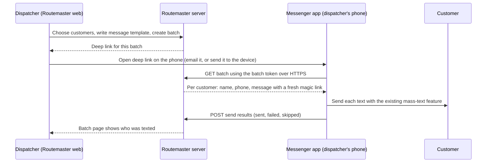

# Sprinkler Messenger Integration Spec

Status: Proposed. Nothing in this document is built, in Routemaster or in Sprinkler Messenger. The open questions are [issue 37](https://github.com/masontuft/routemaster/issues/37).

This file is written to be handed to the Sprinkler Messenger project (React Native). It describes the feature from both sides so the mobile app can be built against it. Anything about Sprinkler Messenger's current code is an assumption to verify; it was written from a description of the app, not from reading its code.

## Goal

A dispatcher in Routemaster picks a group of customers, and Sprinkler Messenger on the dispatcher's own phone texts each customer their own scheduling link, using the phone's number and the native Messages app. The dispatcher no longer copies and pastes links one at a time.

## Terms

| Term | Meaning |
| --- | --- |
| Routemaster | The server-rendered web app (Node, Express, PostgreSQL, deployed on Render) |
| Messenger | Sprinkler Messenger, the React Native app, which already has a mass-texting feature |
| Batch | A list of customers chosen in Routemaster to receive a text |
| Magic link | A per-customer scheduling URL that identifies one customer (see `docs/adr/0012-customer-access-by-link.md`) |
| Batch token | A random secret in the deep link that lets Messenger fetch one batch |

## Flow



Text version: the dispatcher creates a batch in Routemaster and gets a deep link. Opening that link on the phone launches Messenger. Messenger fetches the batch from Routemaster, sends one text per customer through its mass-text feature, and reports the results back.

## Deep link

Two forms are possible. Decide with the Messenger project which to build first.

| Form | Example | Notes |
| --- | --- | --- |
| Custom scheme | `sprinklermessenger://batch/<batchToken>` | Simple to build. Tappable from email and Messages. Another app could register the same scheme, so the link must carry nothing that is valuable by itself beyond the batch token |
| Universal link / App Link | `https://<routemaster-host>/m/<batchToken>` | Needs the `apple-app-site-association` and `assetlinks.json` files served from the Routemaster domain. Falls back to a web page if the app is not installed. More setup |

Rules for either form:
- The link holds only the batch token. It never holds phone numbers, names, or magic links.
- If Messenger is not installed, the web fallback page (universal link form) says so.
- Opening the link must not send anything. Messenger shows a confirmation screen with the customer count, the message template and a Send button.

## Routemaster API (new, Not currently implemented)

Routemaster has no JSON API today (`docs/api/endpoints.md`). This feature would add two endpoints, used only by Messenger.

### `GET /api/messenger/batches/:batchToken`

Returns the batch and mints one magic link per customer at this moment. Raw magic-link tokens are not stored in the database (only hashes), so they can only be returned when created.

```json
{
  "batchId": 42,
  "expiresAt": "2026-11-05T18:00:00Z",
  "recipients": [
    {
      "recipientId": 1001,
      "customerName": "Ann Lee",
      "phone": "+12085550101",
      "message": "Hi Ann, schedule your sprinkler blowout here: https://<host>/l/<magic-token>"
    }
  ]
}
```

Errors: `404` for an unknown, expired or revoked token (the same response for all three), `429` when rate limited.

Behavior to settle: fetching a second time should revoke the links minted by the first fetch and mint new ones, or return `409` so a batch cannot be sent twice by accident. Recommended: return `409` after the first successful fetch and let the dispatcher create a new batch.

### `POST /api/messenger/batches/:batchToken/results`

```json
{
  "results": [
    { "recipientId": 1001, "status": "sent", "at": "2026-11-05T17:12:03Z" },
    { "recipientId": 1002, "status": "failed", "error": "no signal" },
    { "recipientId": 1003, "status": "skipped" }
  ]
}
```

`status` is one of `sent`, `failed`, `skipped`. Routemaster stores these on the batch so the dispatcher can see who was texted and retry the rest. "Sent" means Messenger handed the message to the phone's messaging system. It does not mean the customer received it.

## Messenger app requirements

1. Register the deep link and handle it when the app is closed, in the background, or open.
2. Fetch the batch over HTTPS only. Reject a certificate error.
3. Show a confirmation screen before sending: customer count, the first message as a preview, and a Send button.
4. Feed the recipients into the existing mass-text feature. Verify first whether that feature can accept a per-recipient message body. If it only sends the same text to everyone, it needs that change, because every customer's link is different.
5. Keep phone numbers and links in memory only while the batch is being sent. Do not write them to persistent storage or logs. Clear them when done.
6. Report results back, and retry the result upload if the network drops.
7. Handle: an expired or already-used token, an empty batch, a phone number that is invalid, the app killed mid-batch, and the dispatcher cancelling.
8. Do not require the dispatcher to log in with a password if the batch token is the credential, but see the security section.

## Platform limits to check before committing

These are from general knowledge, not verified against the current Messenger code or current platform documentation.

- **iOS:** an app cannot send SMS silently. The system message composer (`MFMessageComposeViewController`) must be shown and the user taps Send for each message. A batch of hundreds therefore needs a tap per customer, or a different approach. Check how the existing mass-text feature handles this.
- **Android:** sending SMS programmatically needs the `SEND_SMS` permission, and Google Play restricts which apps may request it. Check the Play policy for Messenger's distribution method.
- **Carrier filtering:** bulk texts from one personal number can be throttled or flagged as spam. Pace sends and keep batches modest. The right batch size is unknown.
- **Consent and opt-out:** texting customers has legal requirements that vary by country and state (consent, identification, opt-out). Confirm what the company already has. This document is not legal advice.

## Security

- The batch token is a bearer secret. Generate 32 random bytes, store only a hash, and expire it (suggested: 1 hour, one successful fetch).
- The batch response contains phone numbers and working magic links, so it is personal data. Serve it only over TLS, never log it, and send `Cache-Control: no-store`.
- A deep link sent by email can be forwarded or read. Short expiry and the single fetch limit the damage. Sending the link to a specific device (for example a messaging channel only the dispatcher uses) is safer than email.
- Rate limit both endpoints per IP.
- A magic link inside a text is a bearer link too. The expiry from ADR 0012 applies (30 days by default). Consider a shorter expiry for texted links.
- Routemaster logs which user created the batch (`created_by`) and when each recipient was sent.

## Routemaster work (not in Messenger)

- Migrations: `messenger_batches` (id, created_by, token_hash, message_template, status, expires_at, fetched_at, created_at) and `messenger_batch_recipients` (batch_id, customer_id, status, sent_at). Delete rules decided when written.
- Staff pages: pick customers (by status, by area, or a search), edit the message template, create the batch, show the deep link, show results.
- The two API endpoints above, with tests for expiry, a second fetch, an unknown token and a partial results upload.
- Update `docs/api/endpoints.md` and the security assessment, and add an ADR: this ends Routemaster's "no JSON API" stance for these two routes.
- Prerequisite: the staff customer search and link management from the dashboard segment.

## Acceptance criteria

1. A dispatcher can create a batch of at least 50 customers in Routemaster and get a deep link.
2. Opening the link on a phone with Messenger installed shows a confirmation screen with the correct count, and sends nothing until Send is tapped.
3. Each customer receives a text containing only their own magic link, and that link identifies only them.
4. After sending, the Routemaster batch page lists each recipient as sent, failed or skipped.
5. Opening the same deep link a second time does not send again.
6. An expired token shows a clear error in the app and returns 404 from the API.
7. No phone number or magic link is written to device storage or server logs.

## Open questions

1. Can Messenger's mass-text feature send a different body to each recipient today?
2. How does it deal with the iOS tap-per-message limit?
3. Custom scheme or universal link first?
4. Does the dispatcher use one phone, or several?
5. What batch size is realistic given carrier filtering?
6. Does the company already hold customer consent for texts?
7. Should a texted magic link expire sooner than 30 days?
