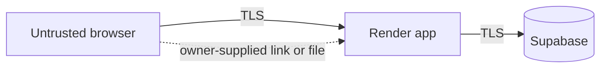

# Threat Model

Lightweight STRIDE over the proposed design. Nothing here is built.

Assets: customer personal data, password hashes, sessions, the database. Entry points: forms, login, the import link and upload.

| Threat | Example | Planned mitigation |
| --- | --- | --- |
| Spoofing | Stolen or guessed session | Secure cookie flags, bcrypt, strong secret |
| Tampering | SQL injection, forged form post | Parameterized queries, CSRF protection (open) |
| Repudiation | Disputed status change | `status_history` records who changed what |
| Information disclosure | Customer reads another's data, stack trace shown | Ownership checks, global error handler |
| Denial of service | Huge upload | Size limit; no rate limiting planned yet |
| Elevation of privilege | Customer reaches admin route | Role middleware, tested denied cases |
| SSRF | Import link pointing at an internal host | Only a fixed `docs.google.com` path |

Residual risk and assumptions will be written when the code exists.
