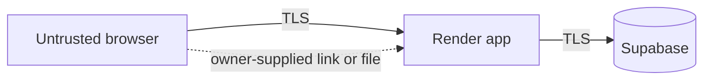

# Threat Model

Lightweight STRIDE. A mitigation marked built is in the current code. Render deployment, spreadsheet import, and daily route assignment are not built.

Assets: customer personal data, password hashes, sessions, reviews, contact messages, the database. Entry points that exist: forms, login, magic links, and the generic `/schedule` link. The import link and file upload are not built.

The diagram is the planned deploy. The app runs locally against `DATABASE_URL`. Supabase and Render are not deployed.

| Threat | Example | Mitigation |
| --- | --- | --- |
| Spoofing | Stolen or guessed session | Built: `httpOnly` and `sameSite: "lax"` cookies, `secure` when `NODE_ENV` is exactly `production`, bcrypt, secret from the environment. Render is unverified ([#21](https://github.com/masontuft/routemaster/issues/21)). |
| Tampering | SQL injection, forged form post | Built: parameterized queries, and `csrf-sync` in `src/middleware/csrf.js` (wired in `src/app.js`) |
| Repudiation | Disputed status change | Built: `status_history` records who changed what (`changed_by`) and an optional note |
| Information disclosure | Customer reads another's data, stack trace shown | Built: ownership checks, and the global error handler does not send error details to the browser |
| Denial of service | Repeated login or form posts | Built: in-memory per-IP rate limit on login, link redemption, `/schedule`, and contact. It resets on restart and is per instance. An `.xlsx` upload size limit is not built ([#33](https://github.com/masontuft/routemaster/issues/33)). |
| Elevation of privilege | Customer reaches an owner route | Built: `requireRole` on `/admin`, `/staff`, `/requests`, and `/properties`, with tests for denied cases |
| SSRF | Import link pointing at an internal host | Not built. Planned: only a fixed `docs.google.com` path ([#33](https://github.com/masontuft/routemaster/issues/33)) |

Residual risk that is still open: the rate limit is per process ([#36](https://github.com/masontuft/routemaster/issues/36) for CAPTCHA or another spam control), magic links are bearer tokens, `localhost` and `127.0.0.1` are different hosts to the test-database guard ([#31](https://github.com/masontuft/routemaster/issues/31)), and the `minimatch` advisory is unresolved ([#32](https://github.com/masontuft/routemaster/issues/32)).
