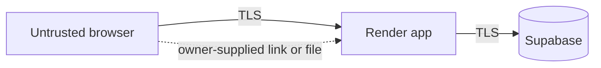

# Threat Model

Lightweight STRIDE. A mitigation marked built is in the current code. Render deployment, the spreadsheet import route, and daily route assignment are not built. The fetch and parse modules are in `src/import/`.

Assets: customer personal data, password hashes, sessions, reviews, contact messages, the database. Entry points that exist: forms, login, magic links, and the generic `/schedule` link. The import link and file upload are not routed. The download and parse functions exist and are not wired to a request.

The diagram is the deploy. Mason reported on 2026-11-02 that the Render service is deployed and `/health` responds through the Supabase session pooler.

| Threat | Example | Mitigation |
| --- | --- | --- |
| Spoofing | Stolen or guessed session | Built: `httpOnly` and `sameSite: "lax"` cookies, `secure` when `NODE_ENV` is exactly `production`, bcrypt, secret from the environment. The Secure cookie behind Render's proxy was not part of the 2026-11-02 deploy report. |
| Tampering | SQL injection, forged form post | Built: parameterized queries, and `csrf-sync` in `src/middleware/csrf.js` (wired in `src/app.js`) |
| Repudiation | Disputed status change | Built: `status_history` records who changed what (`changed_by`) and an optional note |
| Information disclosure | Customer reads another's data, stack trace shown | Built: ownership checks, and the global error handler does not send error details to the browser |
| Denial of service | Repeated login or form posts, or a huge spreadsheet | Built: in-memory per-IP rate limit on login, link redemption, `/schedule`, and contact. It resets on restart and is per instance. The download and the parser both stop at 5 MiB, and a zip that declares more than 50 MiB uncompressed or 200 entries is refused before ExcelJS loads it (`src/import/zipLimits.js`; the sizes are the archive's own claim, so a hostile file can lie) ([ADR 0009](../adr/0009-spreadsheet-import-and-sync.md)). The owner-only link route `POST /admin/import`, `/admin/import/mapping`, `/admin/import/preview` and `/admin/import/confirm` are built and use the shared limiter. Each re-downloads the sheet, so one import session spends about four requests of that budget. Confirm is guarded by a plan hash and a transaction-scoped advisory lock, so a double submit or a changed sheet writes nothing. An upload route is not built ([#33](https://github.com/masontuft/routemaster/issues/33)). |
| Elevation of privilege | Customer reaches an owner route | Built: `requireRole` on `/admin`, `/staff`, `/requests`, and `/properties`, with tests for denied cases |
| SSRF | Import link pointing at an internal host | Built in `src/import/googleSheet.js`: the pasted link cannot choose the host, and redirects off Google's export path are refused. Tested with a mocked network. The owner-only `POST /admin/import` calls it ([#33](https://github.com/masontuft/routemaster/issues/33)). |

Residual risk that is still open: the rate limit is per process, spam control on reviews, contact, and the generic link is planned and not built ([roadmap](../product/roadmap.md#spam-control), [#36](https://github.com/masontuft/routemaster/issues/36)), magic links are bearer tokens, and the test-database guard does not resolve DNS (it treats `localhost`, `127.0.0.1`, and `::1` as the same server and compares every other host as written).
