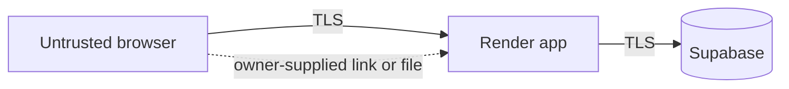

# Threat Model

Lightweight STRIDE. A mitigation marked built is in the current code. Render deployment, the spreadsheet import route, and daily route assignment are not built. The fetch and parse modules are in `src/import/`.

Assets: customer personal data, password hashes, sessions, reviews, contact messages, the database. Entry points that exist: forms, login, magic links, and the generic `/schedule` link. The import link and file upload are not routed. The download and parse functions exist and are not wired to a request.

The diagram is the deploy. Mason reported on 2026-11-02 that the Render service is deployed and `/health` responds through the Supabase session pooler.

| Threat | Example | Mitigation |
| --- | --- | --- |
| Spoofing | Stolen or guessed session | Built: `httpOnly` and `sameSite: "lax"` cookies, `secure` when `NODE_ENV` is exactly `production`, bcrypt, secret from the environment. The Secure cookie behind Render's proxy was not part of the 2026-11-02 deploy report. |
| Tampering | SQL injection, forged form post | Built: parameterized queries, and `csrf-sync` in `src/middleware/csrf.js` (wired in `src/app.js`) |
| Repudiation | Disputed status change | Built: `status_history` records who changed what (`changed_by`) and an optional note |
| Information disclosure | Customer reads another's data, stack trace shown | Built: ownership checks, and the global error handler does not send error details to the browser |
| Denial of service | Repeated login or form posts, or a huge spreadsheet | Built: in-memory per-IP rate limit on login, link redemption, `/schedule`, and contact. It resets on restart and is per instance. The download and the parser both stop at 5 MiB, and a zip that declares more than 50 MiB uncompressed or 200 entries is refused before ExcelJS loads it (`src/import/zipLimits.js`; the sizes are the archive's own claim, so a hostile file can lie) ([ADR 0009](../adr/0009-spreadsheet-import-and-sync.md)). The owner-only link route `POST /admin/import`, `/admin/import/mapping`, `/admin/import/preview` and `/admin/import/confirm` are built and use the shared limiter. Each re-downloads the sheet, so one import session spends about four requests of that budget. Confirm is guarded by a plan hash and a transaction-scoped advisory lock, so a double submit or a changed sheet writes nothing. An upload route is not built ([#33](https://github.com/masontuft/routemaster/issues/33)). |
| Elevation of privilege | Customer reaches an owner route | Built: `requireRole` on `/admin`, `/staff`, `/requests`, and `/properties`, with tests for denied cases |
| SSRF | Import link pointing at an internal host | Built in `src/import/googleSheet.js`: the pasted link cannot choose the host, and redirects off Google's export path are refused. Tested with a mocked network. The owner-only `POST /admin/import` calls it ([#33](https://github.com/masontuft/routemaster/issues/33)). |

Residual risk that is still open: the rate limit is per process, spam control on reviews, contact, and the generic link is planned and not built ([roadmap](../product/roadmap.md#spam-control), [#36](https://github.com/masontuft/routemaster/issues/36)), magic links are bearer tokens, and the test-database guard does not resolve DNS (it treats `localhost`, `127.0.0.1`, and `::1` as the same server and compares every other host as written).

## Deleting customers

Deleting customers is the first destructive owner action, so it has its own checks. Every delete route requires the owner role, and the single-customer delete checks the role in its controller, not only in the view. Every delete is a POST behind CSRF. A confirmation page lists what will go, and a bulk delete carries those counts back and is refused if they changed, with a table lock held so nothing is added between the count and the delete. Deleting every customer also needs a typed phrase. The residual risks are a compromised owner session, which can delete everything with no undo, and no audit trail of who deleted what. This repo does not record whether the Supabase project has a backup to restore from, so treat a delete as final.

## Bulk scheduling links

`/staff/link-batches` makes live links for every customer in an area and shows their names and phones on one page, so it is the largest single exposure of customer data in the app. It is limited to the owner and dispatcher, runs behind CSRF and the shared per-IP limiter, caps a batch at 500 links and 120 days, and sends `no-store` so the page is not cached or replayed. Only token hashes are stored, as for a single link. Each run is recorded in `link_batches` with who ran it. The CSV prefixes cells that start with `=`, `+`, `-` or `@` so a spreadsheet does not run them as formulas, and the message is built in one pass so a customer name cannot expand into a template marker. Residual risks: a stolen staff session can pull a whole area's names, phones and live links; the copied list sits wherever the user pastes it; and there is no revoke-a-whole-batch screen yet (each link can be revoked from its customer's page).

## Routes and map lookups

Building a route sends each customer's street, city and ZIP (and the start address) to Google, when a key is set, and to OpenStreetMap's Nominatim. This is a new trust boundary and the first time customer addresses leave the app and the database. Names and phones are not sent. Only owners and dispatchers can trigger a lookup, both POSTs run behind CSRF and the shared per-IP limiter, and at most 15 addresses are looked up per click. A property is looked up once and the point is kept, so an address is sent again only after it changes or after a failed lookup is retried. Errors never contain the request URL, because the Google key is in it, and the key is read from the environment and never stored or shown. Pages that list names, phones and addresses are sent `no-store`. The day board and the route page are limited to the owner and dispatcher, and each booking goes through the same status-change checks as a single request. The Maps links open in a new tab with `noopener noreferrer`, and `|` is removed from addresses so one cannot add a stop. Residual risks: the map services see the addresses and can log them; a stolen staff session can read a day's names, phones and addresses; a bad lookup can place a stop in the wrong spot, which is why imprecise Google results are not trusted and failed addresses are listed for staff.

## Scheduling options, rebooking and tentative bookings

`/admin/settings` is owner-only, a POST behind CSRF, and accepts only the values a setting lists. Turning on tentative booking lets owners and dispatchers create bookings for customers who did not ask for them, so the day board refuses `/staff/day-board/pencil` unless the option is on, takes only customer ids from the form, and picks the property, the service and the day itself. Each customer is handled in its own transaction with the customer row locked, so a customer who books at the same moment is not booked twice. A customer can confirm, change or cancel only their own tentative booking, because the request is looked up by both its id and the signed-in customer. `/staff/rebooking` lists names and phones, so it is staff-only and `no-store`, and its link maker ignores any ticked customer who is not in the chosen area, so a forged form cannot reach outside it. Making links for all areas runs one transaction per area and shows every customer's name, phone and live link on one page, so it is the same exposure as a batch but not limited to 500 links; the ticked customers are the only bound, and the form parser accepts up to 5,000 fields with the 100 kb body limit. A forged form still cannot reach a customer outside the ticked ids, and ids that belong to nobody are dropped. Residual risks: nothing is sent to a penciled-in customer, so a staff member can book a day a customer never agreed to; the first customer sign-in to a link is the only proof of identity; and the audit trail is the status history, which records who penciled in or confirmed, but not who changed the setting beyond its last editor.
